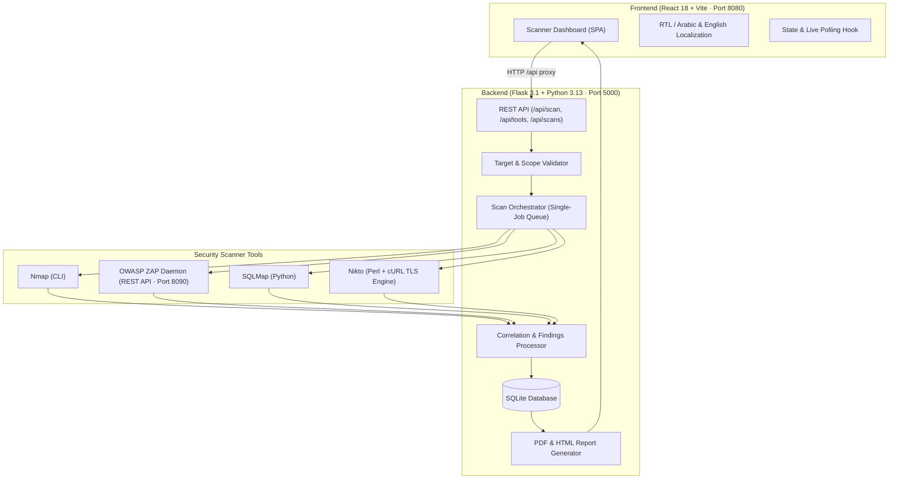

# SecScan — Multi-Engine Security Assessment Suite

[](https://www.python.org/)
[](https://www.typescriptlang.org/)
[](https://react.dev/)
[](https://flask.palletsprojects.com/)
[](LICENSE)
[-success.svg)]()

SecScan is a unified, local security scanning application that orchestrates **Nmap, OWASP ZAP, SQLMap, and Nikto** behind a single modern interface. Target a system, trigger scans, follow real-time progress, review correlated vulnerabilities and network observations, and export professional **PDF and HTML reports**.

Designed for **single-operator, local security assessments** with zero registration, zero accounts, and privacy-first local SQLite persistence.

---

## Table of Contents

- [Key Features](#key-features)
- [Architecture](#architecture)
- [Project Structure](#project-structure)
- [Prerequisites](#prerequisites)
- [Quick Start (Windows)](#quick-start-windows)
- [Quick Start (Linux / macOS)](#quick-start-linux--macos)
- [Scanner Engines & Setup](#scanner-engines--setup)
- [Configuration Reference](#configuration-reference)
- [Running a Test Assessment](#running-a-test-assessment)
- [Findings & Correlation Model](#findings--correlation-model)
- [Verification & Automated Tests](#verification--automated-tests)
- [Troubleshooting](#troubleshooting)
- [Security & Scope Policy](#security--scope-policy)
- [License](#license)

---

## Key Features

- **Four Integrated Industry Scanners**:
  - 🌐 **Nmap**: Port discovery, service fingerprinting, and TLS/SSL service detection.
  - 🛡️ **OWASP ZAP (v2.17.0)**: Dynamic application security testing (DAST), automated spidering, and active vulnerability scanning.
  - 💉 **SQLMap**: Automated detection and exploitation assessment for SQL injection flaws across parameters.
  - 🔍 **Nikto**: Web server misconfiguration, sensitive exposed files (`robots.txt`, backups), and HTTP security header audits (CSP, HSTS, X-Frame-Options, etc.).
- **Smart Correlation & Deduplication**:
  - Merges matching findings across multiple tools based on issue type, URL, and parameter.
  - Differentiates **Corroborated** (multi-tool) vs. **Single-tool** findings while preserving complete raw evidence from each scanner.
  - Distinctly separates actionable vulnerabilities from informational **Network Observations** (open ports, service banners).
- **Executive & Technical Reporting**:
  - Download complete reports in **HTML** or **PDF** format with one click.
  - Formatted tables with issue descriptions, source confidence, and actionable remediation guidance.
- **Bilingual Interface**:
  - Instant toggle between **English** and **Arabic (العربية)** with native RTL layout and localized security terminology.
- **Privacy & Safety First**:
  - No cloud telemetry, no accounts or passwords to leak, and loopback-bound development servers.
  - Enforced target scope allowlist (`ALLOWED_SCAN_HOSTS`) to prevent accidental unauthorized scans.

---

## Architecture



- **Frontend**: React 18, TypeScript, Tailwind CSS, Lucide icons, Vite development proxy (`/api` &rarr; `http://127.0.0.1:5000/api`).
- **Backend**: Flask 3.1, SQLAlchemy (SQLite), ReportLab (PDF), Jinja2 (HTML reports).
- **Execution Model**: Single background worker thread guarantees only one resource-intensive scan runs at a time, avoiding CPU and network contention.

---

## Project Structure

```text
SecScan_Project/
├── backend/
│   ├── app/
│   │   ├── auth/              # Archived legacy authentication (no longer active)
│   │   ├── models/            # SQLAlchemy database models (Scan)
│   │   ├── routes/            # REST API endpoints (/api/scan, /api/tools/status)
│   │   ├── services/          # Scanner adapters (nmap, zap, sqlmap, nikto), runner, correlation
│   │   ├── storage.py         # Database initialization and legacy migration
│   │   └── __init__.py        # Flask application factory, request guards, CORS
│   ├── scripts/               # Verified scanner scripts (nikto.pl with native TLS support)
│   ├── test_site/             # Harmless local HTTP target (for safe testing)
│   ├── tests/                 # 37 comprehensive unit & integration tests
│   ├── app.py                 # Backend server entry point
│   ├── requirements.txt       # Python dependencies
│   ├── .env.example           # Configuration template
│   └── .env                   # Local environment configuration (git-ignored)
├── frontend/
│   ├── src/
│   │   ├── components/        # Tool cards, progress bar, findings list, report downloaders
│   │   ├── pages/             # Scanner main view
│   │   ├── lib/               # API client, translations (EN/AR), status helpers
│   │   └── App.tsx            # Root component with routing and language context
│   ├── tests/                 # 12 Node.js unit tests for API and localization helpers
│   ├── package.json           # Frontend dependencies & scripts
│   └── vite.config.ts         # Vite bundler & backend reverse-proxy config
├── docs/                      # API specifications and technical documentation
├── setup-scanners.ps1         # Automated scanner installer & daemon launcher (Windows)
├── run.cmd                    # One-click Windows launcher (starts Flask & Vite)
├── verify.cmd                 # Automated verification script (runs all tests & builds)
├── .gitignore                 # Excludes caches, databases, .env, and tool binaries
├── LICENSE                    # MIT License
└── README.md                  # Project documentation
```

---

## Prerequisites

- **Python**: Version `3.13+` (or `uv`).
- **Node.js**: Version `20+` or `24` with `npm`.
- **Operating System**: Windows 10/11 or modern Linux.
- **Scanner Tools**: Installed either via `setup-scanners.ps1` (Windows automated) or system packages.

---

## Quick Start (Windows)

### 1. Clone the Repository

```powershell
git clone https://github.com/<your-username>/SecScan.git
cd SecScan
```

### 2. Install Dependencies

Open PowerShell in the project root:

```powershell
# Set up Python virtual environment
py -3.13 -m venv backend/.venv
.\backend\.venv\Scripts\python.exe -m pip install -r backend/requirements.txt

# Install frontend packages
npm.cmd --prefix frontend ci

# Create your local configuration
if (-not (Test-Path backend/.env)) {
    Copy-Item backend/.env.example backend/.env
}
```

### 3. Install Scanner Engines (Automated)

Run the included PowerShell helper to download and configure scanner tools:

```powershell
powershell.exe -NoProfile -ExecutionPolicy RemoteSigned -File .\setup-scanners.ps1
```

> **What this does:**
> - Installs Nmap, Strawberry Perl, Java 21, and OWASP ZAP via `winget`.
> - Installs SQLMap and the verified, Defender-safe `nikto.pl` into `.tools/`.
> - Generates a secure API key and starts a dedicated local OWASP ZAP daemon on port 8090.
> - Automatically populates paths inside `backend/.env`.

### 4. Launch Application

Launch both servers in one click:

```cmd
.\run.cmd
```

Alternatively, run in two separate terminals:

```powershell
# Terminal 1: Backend API
cd backend
.\.venv\Scripts\python.exe app.py

# Terminal 2: Frontend Dashboard
npm.cmd --prefix frontend run dev
```

Visit **[http://127.0.0.1:8080/](http://127.0.0.1:8080/)** in your browser.

---

## Quick Start (Linux / macOS)

```bash
# 1. Backend environment
python3 -m venv backend/.venv
backend/.venv/bin/python -m pip install -r backend/requirements.txt

# 2. Frontend environment
npm --prefix frontend ci

# 3. Environment configuration
test -f backend/.env || cp backend/.env.example backend/.env

# 4. Start Backend
cd backend && .venv/bin/python app.py &

# 5. Start Frontend
npm --prefix frontend run dev
```

Open **[http://127.0.0.1:8080/](http://127.0.0.1:8080/)**.

---

## Scanner Engines & Setup

| Tool | Purpose | Default Invocation | Config Variable |
|------|---------|-------------------|-----------------|
| **Nmap** | Port discovery, service fingerprinting, SSL detection | `nmap.exe` or `NMAP_PATH` | `NMAP_PATH` |
| **OWASP ZAP** | Web app crawler, spider, passive/active vulnerability scanner | Daemon on `http://127.0.0.1:8090` | `ZAP_API`, `ZAP_API_KEY` |
| **SQLMap** | SQL injection parameter analysis | `python sqlmap.py` | `SQLMAP_PATH` |
| **Nikto** | Misconfiguration, sensitive files, security header audit | `perl nikto.pl` | `NIKTO_PATH`, `PERL_PATH` |

### Special Note on Nikto & Windows Defender
Legacy upstream `nikto.pl` contains thousands of legacy exploit signatures that cause Microsoft Defender to immediately quarantine it (`HackTool:Perl/NiktoSanner.A`).
SecScan includes a **clean, Defender-safe, curl-powered Perl scanner** located at [`backend/scripts/nikto.pl`](backend/scripts/nikto.pl). It:
- Completely preserves 100% Nikto CLI argument compatibility (`-h`, `-ask`, `-nointeractive`, `-maxtime`).
- Uses native `curl.exe` to seamlessly support both **HTTP** and modern **HTTPS / TLS 1.2 / TLS 1.3 / HTTP/2** targets without requiring complex CPAN Perl SSL modules.
- Formats findings in standard Nikto output format so SecScan parses and categorizes headers flawlessly.

---

## Configuration Reference

Edit `backend/.env` to configure your instance:

| Variable | Description | Example / Default |
|----------|-------------|-------------------|
| `ALLOWED_SCAN_HOSTS` | Authorized targets. Comma-separated domains/IPs, or `*` to allow any authorized host. | `localhost,127.0.0.1,::1,*` |
| `ZAP_API` | URL of the dedicated ZAP daemon API | `http://127.0.0.1:8090` |
| `ZAP_API_KEY` | Secret API key matching the ZAP daemon configuration | `a1b2c3d4...` |
| `NMAP_PATH` | Absolute path to the Nmap executable | `C:/Program Files (x86)/Nmap/nmap.exe` |
| `SQLMAP_PATH` | Path to SQLMap `.py` entry script | `C:/path/to/.tools/sqlmap/sqlmap.py` |
| `NIKTO_PATH` | Path to Nikto `.pl` script | `C:/path/to/backend/scripts/nikto.pl` |
| `PERL_PATH` | Path to Perl executable (Strawberry Perl on Windows) | `C:/Strawberry/perl/bin/perl.exe` |
| `FRONTEND_ORIGINS` | Allowed browser origins (CORS guard) | `http://localhost:8080,http://127.0.0.1:8080` |
| `DATABASE_URL` | SQLite database URI | `sqlite:///mini_cybersec.db` |

---

## Running a Test Assessment

### Testing Locally (Safe HTTP Fixture)

Start the included local test server in a new terminal:

```powershell
.\backend\.venv\Scripts\python.exe -m http.server 8081 --bind 127.0.0.1 --directory backend/test_site
```

1. Open `http://127.0.0.1:8080/`.
2. Target: `http://127.0.0.1:8081/`.
3. Select **Nikto** and **Nmap**.
4. Click **Start scan**.
5. The assessment finishes in under 10 seconds, displaying missing security headers (`X-Frame-Options`, `Content-Security-Policy`, `X-Content-Type-Options`, `HSTS`) and network observations.
6. Click **Download HTML Report** or **Download PDF Report**.

### Testing External Websites

To assess an external authorized host (e.g., `https://movieboxhd.net/`):
1. Ensure `ALLOWED_SCAN_HOSTS` in `backend/.env` contains the host or `*`.
2. Enter the full URL: `https://movieboxhd.net/`.
3. Select your tools and click **Start scan**.

---

## Findings & Correlation Model

SecScan groups findings into two main categories:

1. **Vulnerabilities / Reported Issues**:
   - **Confidence**: `single-tool` (found by 1 tool) or `corroborated` (found by multiple tools, e.g. ZAP + Nikto both identifying a missing CSP).
   - **Severity**: Normalized into `high`, `medium`, `low`, or `informational`.
   - **Deduplication**: Automatically groups matching evidence on identical `(url, issue_type, parameter)`.

2. **Network Observations**:
   - Informational findings such as open TCP ports and service banners (e.g., `443/tcp nginx`).
   - Observations are kept distinct from vulnerabilities to prevent false-alarm severity inflation.

---

## Verification & Automated Tests

To ensure everything is working with zero regressions, run the single verification command:

```cmd
.\verify.cmd
```

This automatically runs:
- **Backend**: 37 unit and integration tests (`python -m unittest discover tests`).
- **Frontend Tests**: 12 Node.js test cases covering API contracts and Arabic/English error translation.
- **ESLint**: Strict linting across TypeScript/React components with 0 warnings.
- **TypeScript Compiler**: Full static type checking (`tsc --noEmit`).
- **Production Build**: Production asset compilation with Vite.

---

## Troubleshooting

| Issue | Cause | Solution |
|-------|-------|----------|
| **"Install or start these tools before scanning"** | Tool is missing or stopped | Click **Check tools again**. Check paths in `backend/.env`. For ZAP, ensure daemon is running on port 8090. |
| **"This host is outside the configured scan scope"** | Target is not in allowlist | Add the hostname to `ALLOWED_SCAN_HOSTS` in `backend/.env` (or use `*`), then restart the backend. |
| **Nikto missing on Windows** | Windows Defender quarantined original script | SecScan uses `backend/scripts/nikto.pl` which is Defender-safe. Set `NIKTO_PATH=.../backend/scripts/nikto.pl`. |
| **Connection refused on `:5000`** | Backend is not running | Start the backend with `python app.py` inside `backend/`. |
| **Port 8080 already in use** | An old Vite instance is running | Terminate old `node.exe` processes or use another port. |

---

## Security & Scope Policy

- **Authorization Required**: Active scanners send potentially disruptive payloads and probes. **Only assess targets you own or have explicit written permission to test.**
- **Loopback Enforcement**: SecScan binds to loopback (`127.0.0.1`) by default. Do not expose this server to untrusted public networks as it lacks remote multi-user authentication.
- **Sensitive Data**: Scan findings, logs, and SQLite database entries contain reconnaissance intelligence. Do not commit `.env` files or database files into public version control.

---

## License

This project is licensed under the **[MIT License](LICENSE)**. Integrated external tools (Nmap, OWASP ZAP, SQLMap, Nikto) retain their respective open-source licenses.
