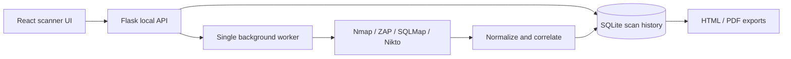

# SecScan single-operator rebuild

## Purpose

Rebuild SecScan as a local, single-operator security assessment application. The project continues to orchestrate Nmap, OWASP ZAP, SQLMap, and Nikto, presents normalized findings, retains scan history, and produces HTML and PDF reports. It no longer creates accounts, signs users in, stores sessions, or separates scan data by user.

The application remains intended only for systems the operator owns or is authorized to assess. The exact target allowlist stays enforced by the backend.

## Scope

The rebuild changes authentication, persistence ownership, API access, frontend routing, automated tests, documentation, and repository hygiene. Scanner adapters, target validation, execution limits, result processing, and report rendering remain part of the product.

Out of scope:

- Multi-user operation or role management.
- Network isolation beyond the documented host allowlist and the operator's own network controls.
- New scanner integrations.
- Production deployment infrastructure.

## Architecture

The browser communicates with the Flask API through the existing Vite development proxy. The API accepts unauthenticated requests from the configured frontend origins. It does not use credentialed browser requests, session cookies, CSRF tokens, account data, or authorization decorators.

The application permits one active scan at a time. A bounded worker starts the selected tools, stores progress and normalized results in SQLite, and releases its slot when the job completes or fails.

## Backend design

### Application setup

`create_app` configures SQLite, the explicit scan-host allowlist, ZAP configuration, and one concurrent scan. It removes session configuration, generated session keys, authentication rate limiting, credentialed CORS, and the authentication blueprint.

CORS applies to `/api/*` using the configured frontend origins without credential support. Security response headers and API error handling remain.

Implementation clarification: allowlisted browser Origins, loopback HTTP Host
values, and JSON mutation bodies are enforced independently of authentication.
Requests marked cross-site are rejected. Local command-line clients do not need
an Origin header.

### Database model and migration

`Scan` owns all persisted scan state. Its fields are: scan ID, target, selected tools, status, timestamps, active tool, completed-tool count, result JSON, and error. It has no user relationship or user ID.

At startup, the application detects a legacy SQLite `scan` table containing `user_id`.

1. In a database transaction, rename the legacy table to `scan_legacy_auth`.
2. Create the current `scan` table with the single-operator schema.
3. Copy every compatible legacy scan record into the new table, omitting only `user_id`.
4. Validate that the copied row count matches the legacy row count before committing.
5. Retain `scan_legacy_auth` and the legacy `user` table. They are never deleted by the application.

Fresh installations create only the new `scan` table. The migration is idempotent: once the active `scan` table no longer contains `user_id`, startup does not run it again.

### API contract

All routes live below `/api` and require no account or CSRF headers.

| Method | Route | Result |
| --- | --- | --- |
| `GET` | `/health` | API status |
| `POST` | `/scan` and `/scan/start` | Queue a validated scan |
| `GET` | `/scans` | Up to 50 newest local scans |
| `GET` | `/scan/<id>/status` | Current scan state |
| `GET` | `/scan/<id>/results` | Final normalized result |
| `GET` | `/scan/<id>/report?format=pdf|html` | Download a completed report |
| `GET` | `/tools/status` | Tool availability and allowed hosts |

The target-validation rules remain unchanged: a submitted host must exactly match `ALLOWED_SCAN_HOSTS`; web scanners require HTTP(S) URLs; and malformed, credential-bearing, or command-like target strings are rejected. Tool availability is still checked before a scan begins.

## Frontend design

The scanner is the main application route (`/`). The `/scanner`, `/login`, and
`/auth-system.html` routes redirect to `/` for compatible existing bookmarks.

The scanner page retains tool selection, target validation feedback, progress polling, scan history, result rendering, exports, localization, keyboard access, and error states. Its header retains the product identity and language toggle, then removes the user name and sign-out button.

The API client removes user and session types, the session bootstrap request, credential inclusion, CSRF token state, authorization events, and login/register/logout functions. It sends JSON for mutations and continues to surface server error messages.

The authentication page, context, helper, and auth-specific tests are removed. Translation entries that only serve account creation, login, logout, or session errors are removed from both supported languages. Route titles describe the scanner directly.

## Test strategy

Backend tests cover:

- unauthenticated access to every scanner route;
- JSON and target validation failures;
- allowlist enforcement for hostnames, IPv4, IPv6, ports, and URL forms;
- single-scan capacity handling;
- progress, persistence, restart handling, results, and reports;
- scanner adapter behavior;
- migration from the legacy user-owned scan schema.

Frontend tests cover:

- API requests without credentials or CSRF headers;
- start, status, history, results, tool status, and export requests;
- scanner active-state handling and error behavior;
- redirect behavior for legacy scanner and auth URLs;
- route titles and account-free UI helpers.

The final verification suite is: backend unit tests, frontend tests, lint, TypeScript checks, and production build.

## Configuration and repository hygiene

The backend environment file contains only scan configuration: `ALLOWED_SCAN_HOSTS`, `ZAP_API`, `ZAP_API_KEY`, `DATABASE_URL`, and optional CORS origin settings. Session and cookie settings are removed.

Implementation clarification: optional `NMAP_PATH`, `SQLMAP_PATH`, and
`NIKTO_PATH` select native executable/script paths. SQLMap Python scripts use the
backend interpreter; Nikto Perl scripts use Perl on PATH. The same resolver is
used by availability checks and subprocess execution.

The repository ignores virtual environments, `node_modules`, Python caches, SQLite databases, generated reports, local `.env` files, logs, and frontend build output. The environment example contains no values that are secrets or machine-specific.

The README is rewritten as the canonical project guide. It explains the architecture, legal and authorized-use boundary, prerequisites, tool installation, Windows and Linux setup, environment configuration, launch commands, local test target, scanner availability, testing, troubleshooting, exports, and safe GitHub publishing.

## Acceptance criteria

- Opening the frontend never requires registration or sign-in.
- The scan API works without cookies or CSRF headers.
- Existing local scan records migrate without losing scan data.
- The four scanner integrations, tool-status display, scan progress, history, findings, and exports operate through the single-operator workflow.
- A fresh clone can be configured using only the rewritten README and environment example.
- No local database, report, secret, package cache, or runtime artifact is included in GitHub commits.
